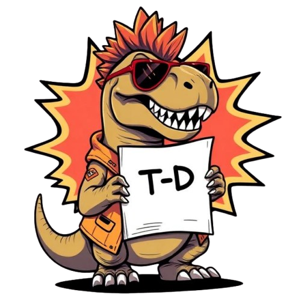

# LitReX



Biomedical relation extraction from literature: classify the relationship
between a **target** and a **disease** as expressed in literature text —
e.g. does the text say the target's upregulation is associated with the
disease, or is it just a co-mention with no real relationship claimed?

This is currently unclassified in the [Open Targets Platform](https://platform.opentargets.org/).
LitReX adds relation classification on top of existing target–disease
co-occurrence evidence, at a scale of billions of rows, to unlock better
evidence scoring and a richer front-end presentation.

## Pipeline

```
[Data sources]
  Open Targets Cooccurrence (already ID-normalized)  ─┐
  GWAS Catalog (needs OnToma normalization)           ─┼─► Cooccurrence(target, disease, text)
        │
        ▼
[Sampling] representative sample: two-year abstract window,
        │   ≥10% disease/target coverage, ontology-tree spread
        ▼
[LLM labelling] Claude judges the relationship per row
        │
        ▼
Silver-labelled triples: (target, disease, text, relation, confidence)
        │
        ▼
[Classifier training] fine-tune a transformer on the silver labels
        │
        ▼
[Batch inference] score the full billions-row dataset (pandas_udf / pyspark-compatible)
        │
        ▼
Scored relationships, feeding a future front-end + evidence-score revision
```

Every data source produces rows conforming to a shared contract before
entering the sampling stage:

```
Cooccurrence:
  target:  str   # Ensembl gene ID
  disease: str   # EFO ID
  text:    str   # literature text span (sentence/passage) mentioning both
```

(Plus `publication_id`, `publication_date`, and `section`, required by
sampling and downstream cross-referencing — see [`docs/02-data-source-cooccurrence.md`](docs/02-data-source-cooccurrence.md).)

The relation taxonomy (positive-upregulation, positive-downregulation,
negative, neutral) is a starting hypothesis, not a closed set — the LLM
labelling stage is deliberately open-vocabulary; classification into a
fixed taxonomy happens later, at classifier-training time.

## Repo layout

```
src/litrex/
├── schema.py               # Cooccurrence, LabeledTriple, ScoredRelationship (pydantic)
├── config.py                # env-driven settings (pydantic-settings)
├── data_sources/
│   ├── cooccurrence.py      # Open Targets Cooccurrence ingestion
│   └── gwas_catalog.py      # GWAS Catalog + OnToma normalization
├── sampling/
│   ├── representative_sample.py  # filters + coverage metrics + sample draw
│   └── therapeutic_area.py       # ontology-spread metric (EBI OLS4 lookups)
├── labelling/
│   ├── prompts.py            # relationship-judge prompt construction
│   ├── llm_client.py         # batched Claude calls
│   └── entity_names.py       # target/disease ID → display-name lookup
├── training/
│   ├── dataset.py            # silver-dataset splits
│   └── train.py              # fine-tuning loop
└── inference/
    └── batch_score.py        # pandas_udf-wrappable scoring fn
```

`tests/` mirrors `src/litrex/`.

## Status

| Stage | Doc | Status |
|---|---|---|
| 1. Overview & architecture | [`docs/01-overview.md`](docs/01-overview.md) | Agreed |
| 2. Cooccurrence ingestion | [`docs/02-data-source-cooccurrence.md`](docs/02-data-source-cooccurrence.md) | Built and run end-to-end ([log](docs/11-session-log-cooccurrence-ingestion.md)) |
| 3. GWAS Catalog normalization | [`docs/03-data-source-gwas-catalog.md`](docs/03-data-source-gwas-catalog.md) | Built and run end-to-end ([module README](src/litrex/data_sources/gwas/README.md)) |
| 4. Representative sampling | [`docs/04-sampling.md`](docs/04-sampling.md) | Built and run end-to-end ([log](docs/12-session-log-sampling.md)) |
| 5. LLM relationship judge | [`docs/05-llm-labelling.md`](docs/05-llm-labelling.md) | Prompt finalized; one-off 500-row labelling pass done manually — reusable `llm_client.py` API pipeline not yet built ([log](docs/13-session-log-llm-labelling.md)) |
| 6. Classifier training | [`docs/06-classifier-training.md`](docs/06-classifier-training.md) | Not started |
| 7. Batch inference | [`docs/07-inference.md`](docs/07-inference.md) | Not started |
| 8. Product vision | [`docs/08-product-vision.md`](docs/08-product-vision.md) | Directional plan only, revisit after stage 7 |

See [`docs/10-open-questions.md`](docs/10-open-questions.md) for outstanding
decisions and [`docs/README.md`](docs/README.md) for the full doc index and
reading order.

## Setup

Requires Python ≥3.11 and [`uv`](https://docs.astral.sh/uv/).

```bash
uv sync                    # base install
uv sync --extra training   # + torch/transformers/datasets for stage 6
uv sync --extra spark      # + pyspark for stage 7 integration
```

Configuration is env-driven via a local `.env` (gitignored), read by
[`src/litrex/config.py`](src/litrex/config.py):

```
LITREX_ANTHROPIC_API_KEY=...
LITREX_ANTHROPIC_MODEL=claude-sonnet-5
LITREX_PLATFORM_TOTAL_DISEASES=...
LITREX_PLATFORM_TOTAL_TARGETS=...
```

## Development

```bash
uv run pytest    # tests
uv run ruff check .   # lint
```

Runnable pipeline stages so far:

```bash
uv run python -m litrex.data_sources.cooccurrence     # stage 2: ingest Cooccurrence Parquet
uv run python -m litrex.sampling.representative_sample # stage 4: draw sample_manifest.parquet
```

## License

[Apache 2.0](LICENSE)
